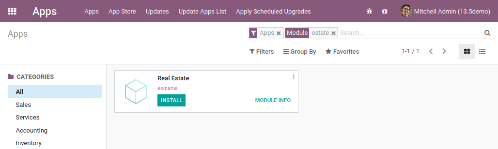

##Odoo Notes

### Chapter 1: Architecture Overview

Odoo follows a multitier architecture, meaning that the presentation, the business logic and the data storage are separated
Both server and client extensions are packaged as modules which are optionally loaded in a database.
A module is a collection of functions and data that target a single purpose.

Everything in Odoo starts and ends with modules.

Terminology: developers group their business features in Odoo modules. The main user-facing modules are flagged and exposed as Apps, but a majority of the modules aren’t Apps. Modules may also be referred to as addons and the directories where the Odoo server finds them form the addons_path.

#### Module Structure

An Odoo module is declared by its manifest.

### Chapter 2: A New Application

We're going to build a real estate advertisement module

It is worth noting that before developing a new module, it is good practice to verify that Odoo doesn’t already provide a way to answer the specific business case.

The goal of this section is to have Odoo recognize our new module, which will be an empty shell for now. It will be listed in the Apps:

A dependency means that the Odoo framework will ensure that these modules are installed before our module is installed.

We're now creating new module, Estate, and setting the init and manifest,
Cehckout manifest for CRM app https://github.com/odoo/odoo/blob/67a952f30731fc00941587ae165b7a885da0e77e/addons/crm/__manifest__.py

Settings -> activate developer mode

Top -> Update App List

### Chapter 3

A key component of Odoo is the ORM layer. This layer avoids having to manually write most SQL and provides extensibility and security services2.

The menu test_model_menu_action is linked to the action test_model_action, and the action is linked to the model test_model. As previously mentioned, the action can be seen as the link between the menu and the model.
